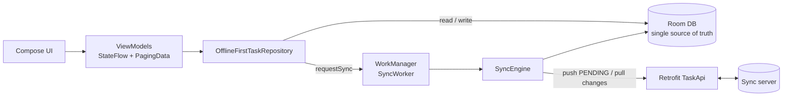

# TaskNest: Offline-First Task Manager (Android)

A task manager that works without the internet and syncs in the background when you're back online, with automatic conflict resolution when the same task is edited on two devices.

Built with **Kotlin, Jetpack Compose, Room, Paging 3, WorkManager, Retrofit, Hilt and Coroutines/Flow**.

---

## Features

- **Works fully offline.** Create, edit, complete, delete and search tasks with no network.
- **Instant UI.** Every action is written to Room first, so the screen never waits on the network.
- **Background sync** with WorkManager. It runs as soon as the device is online, survives app kills and reboots, and retries with exponential backoff.
- **Two-way sync.** Local changes are pushed, and changes from other devices are pulled from a server change feed.
- **Conflict resolution.** Optimistic locking (`baseVersion` → HTTP 409) plus last-write-wins on the edit timestamp.
- **Safe deletes.** Tombstones keep a delete until the server confirms it, so other devices learn about it too.
- **No lost edits mid-sync.** An edit made while that task is uploading stays pending and is uploaded next.
- **Paged list** (Paging 3 + Room) with debounced search, pull-to-refresh and swipe-to-delete.
- **Live sync status:** offline banner, "3 changes waiting to sync", "Syncing…", "Synced 2 min ago", and a cloud icon on each unsynced task.

## Architecture



**Layers:** `ui` (Compose + ViewModels) → `domain` (models + repository interface) → `data` (Room, Retrofit, sync).
The UI reads **only** from Room. The network only ever updates Room.

### How sync works

Each row in Room has a `syncState` (`SYNCED` / `PENDING`), a `serverVersion` and an `updatedAt`.

1. **Write locally.** The change is saved to Room as `PENDING`, and `SyncScheduler.requestSync()` enqueues a WorkManager job.
2. **Push.** For each pending row, `PUT /tasks/{id}` is sent with `baseVersion = serverVersion`.
   - **200:** the row is marked `SYNCED`, but only if it wasn't edited during the upload (`UPDATE … WHERE updatedAt = :expected`).
   - **409:** someone else changed the task first. `ConflictResolver` compares the timestamps:
     - **Local is newer:** the edit is rebased onto the server version and re-uploaded.
     - **Server is newer (or a tie):** the server copy replaces the local one.
3. **Pull.** `GET /tasks/changes?since=<cursor>` pages through the server's change feed. The cursor is a server-side **sequence number**, not a timestamp, so clock differences between devices can't skip changes.
4. **Push again** if the pull rebased any local edits.

## Project structure

```
app/src/main/java/com/arjun/tasknest/
├── data/
│   ├── local/        TaskEntity, TaskDao, TaskNestDatabase, SyncCursorStore (DataStore)
│   ├── remote/       TaskApi + DTOs (Retrofit + kotlinx.serialization)
│   ├── repository/   OfflineFirstTaskRepository
│   ├── sync/         SyncEngine, ConflictResolver, SyncWorker, SyncScheduler
│   └── Mappers.kt
├── domain/           Task, TaskRepository
├── di/               Hilt modules
├── ui/               tasklist/, edit/, navigation/, theme/
└── util/             Clock, ConnectivityObserver
app/src/test/...      SyncEngineTest, ConflictResolverTest, in-memory fakes
server/               Zero-dependency Node.js sync server + tests
.github/workflows/    CI: unit tests, lint, debug APK, server tests
```

## Run it

### 1. Start the sync server (needs Node.js 18+)

```bash
cd server
node server.js          # http://localhost:8080
```

### 2. Run the app

Open the project in **Android Studio** (Ladybug or newer), let Gradle sync, and run the `app` configuration on an **emulator**.
The app connects to `http://10.0.2.2:8080/`, which is your computer as seen from the emulator.

> **Physical phone?** Put your phone and computer on the same Wi-Fi. In `app/build.gradle.kts`, set `BASE_URL` to your computer's IP, e.g. `"http://192.168.1.5:8080/"`, and add that IP to `res/xml/network_security_config.xml`.

### 3. Try the offline-first behaviour

| Try this | What you'll see |
|---|---|
| Turn on **airplane mode**, add or edit tasks | Offline banner, cloud icon on each task, "N changes saved on device" |
| Turn airplane mode **off** | "Syncing…", then "Synced just now"; the tasks show up in `curl localhost:8080/tasks` |
| Edit a task from "another device":<br/>`curl -X POST localhost:8080/debug/edit/<id> -d '{"title":"from laptop"}'` | Pull to refresh: the new title appears |
| Edit the same task on the phone while offline, then go online | Conflict: the newer edit wins on both sides |
| `FAIL_RATE=0.5 node server.js` | Sync keeps retrying with backoff until it succeeds |

## Tests

```bash
./gradlew testDebugUnitTest      # SyncEngine + ConflictResolver (14 tests)
cd server && node --test         # server contract (6 tests)
```

The sync tests run against an in-memory DAO and an in-memory server with the same rules as the real one. They cover:
- uploading tasks created offline
- pulling tasks created on another device
- both conflict outcomes (local wins, server wins)
- tombstone deletes in both directions
- an edit made during an upload
- reading a 450-task change feed page by page

## Tech stack

| Area | Library |
|---|---|
| UI | Jetpack Compose, Material 3, Navigation Compose |
| Architecture | MVVM, repository pattern, offline-first, unidirectional data flow |
| Local data | Room (+ room-paging), DataStore Preferences |
| Lists | Paging 3 |
| Background work | WorkManager (CoroutineWorker, constraints, backoff, unique work) |
| Networking | Retrofit, OkHttp, kotlinx.serialization |
| DI | Hilt (+ HiltWorkerFactory for workers) |
| Async | Kotlin Coroutines, Flow, StateFlow |
| Testing | JUnit, coroutines-test, fakes |
| CI | GitHub Actions |

## Ideas to extend it

- Field-level merging (title from one device, completed state from the other) instead of whole-task last-write-wins
- A user account with an auth token, so each user syncs only their own tasks
- Replace the polling sync with FCM push ("sync now" messages)
- Compose UI tests and Room migration tests
- Multi-module split (`:core:data`, `:core:database`, `:feature:tasks`)
